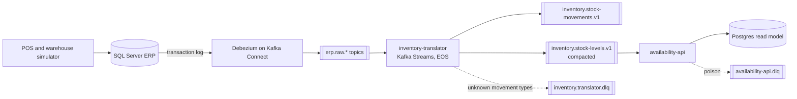

# Architecture

The ERP schema and its stored procedure are never changed. See
[legacy-erp.md](legacy-erp.md) for how to read it.

| Topic | Key | Cleanup | Format |
|---|---|---|---|
| `erp.raw.ERPDB.dbo.INV_*` | table PK | delete, 7 d | JSON, internal |
| `inventory.stock-movements.v1` | `sku:location` | delete, 30 d | Avro, BACKWARD |
| `inventory.stock-levels.v1` | `sku:location` | compact | Avro, BACKWARD |
| `*.dlq` | original | delete, 14 d | original record plus failure headers |

Decisions are in [adr/](adr/).

Not built yet: reconciliation against the ERP, the reservation service
([003](adr/003-strangler-routing-by-sku.md)), dashboards and failure drills.
