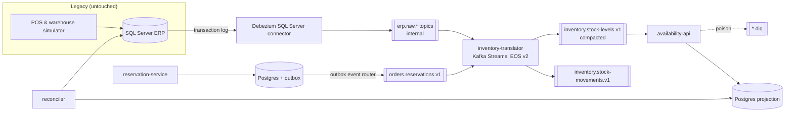

# Design — Legacy Inventory Modernization

> Status: **approved 2026-09-17**, amended by the ADRs in [adr/](adr/). Milestones 1–3 done; milestone 4 next.

## The problem this project solves

A mid-size retailer runs its inventory in a 15-year-old ERP on SQL Server.
Stores and the warehouse write stock movements into it all day. The online
store and a marketplace learn about stock from a **nightly CSV export over
SFTP**, so for up to 24 hours they sell units that no longer exist.

The ERP cannot be rewritten: it is the system of record, its vendor is gone,
and every change to it is risky. The business wants:

1. Stock availability on every sales channel within seconds, not a day.
2. To move online reservations out of the ERP, one capability at a time,
   without a big-bang cutover.
3. Proof that the new pipeline never loses or double-counts a unit, including
   when infrastructure fails.

This is a composite of a very common situation. The retailer is fictional.

## What the project demonstrates

| Client pain | Pattern shown | Evidence in the repo |
|---|---|---|
| Can't modify the legacy system | Change Data Capture (Debezium) | Legacy schema untouched; CDC reads the transaction log |
| Legacy data model leaks everywhere | Anti-corruption layer | Raw CDC topics are internal; only translated domain events are contracts |
| Big-bang rewrites fail | Strangler fig | Reservations move out of the ERP SKU by SKU, behind an ownership table |
| Dual writes lose data | Transactional outbox | New service writes state + event in one DB transaction |
| Duplicates after retries/rebalances | Idempotent consumers, Kafka Streams EOS | Chaos tests assert zero drift |
| Poison messages stall pipelines | Retry topics + DLQ | Test injects malformed events; pipeline keeps flowing |
| Schema changes break consumers | Schema Registry, compatibility rules | Evolution test with old and new consumers running together |
| "Is it actually correct?" | Continuous reconciliation | Job compares ERP totals with projections and alerts on drift |
| "Is it healthy?" | Metrics and consumer lag alerts | Grafana dashboards, Prometheus alert rules |
| "Works on my machine" | Pinned toolchain, containerised build and runtime | Docker is the only requirement to run it; `docker compose up --build` |

## Architecture

### Components

**Legacy ERP (SQL Server + simulator).** The schema is deliberately ugly:
cryptic column names, `CHAR` status codes, a stored procedure that updates
stock and inserts a movement row. A simulator plays stores and the warehouse
at a configurable rate. We never change this schema to suit the new world.
That constraint is the point.

**Debezium on Kafka Connect.** Reads SQL Server CDC tables and publishes one
raw topic per table. The raw topics mirror the legacy model and are **not a
contract**. Only inventory-translator may consume them. See
[ADR 001](adr/001-change-data-capture.md).

**inventory-translator (Kafka Streams).** This is the anti-corruption layer. It
maps raw rows to domain events keyed by `sku:location`: `StockMoved`, with the
sign moved out of the movement type and into the quantity, and
`StockLevelChanged`, with `available = on_hand − reserved` and the source LSN
consumers use to reject stale updates. Legacy quirks are handled here and
nowhere else: padded `CHAR` codes, exact decimals, and `DATETIME` values that
carry local wall-clock time with no zone. It runs with `exactly_once_v2`, so
reads, state updates and writes commit together inside Kafka.

Stock levels come from the ERP's own `INV_STK` rows, which are absolute values,
not from summing movements. Summing would look more impressive and would drift
permanently after a single missed or replayed event; absolute values from the
system of record are self-correcting.

Contracts are files in `contracts/`, published to Schema Registry by a
deliberate step with `BACKWARD` compatibility. Services run with
`auto.register.schemas=false`, so no service can invent a contract at runtime.

**reservation-service (Spring Boot, the strangler step).** Owns online
reservations that used to live in the ERP. It writes the reservation and an
outbox row in one Postgres transaction. Debezium's outbox event router
publishes the outbox rows. An ownership table says, per SKU, whether the ERP
or this service takes its reservations, so one stock position never has two
owners. Migration phases move a growing share of SKUs to the new service;
rollback moves them back. See [ADR 003](adr/003-strangler-routing-by-sku.md).

**availability-api (Spring Boot).** Consumes `stock-levels` into a Postgres
read model and serves `GET /availability/{sku}` with an `asOf` time, so
clients can see how fresh the answer is. The consumer is idempotent: each
upsert is conditional on the event's source LSN, so replays and duplicates
are no-ops. Poison goes to a DLQ byte for byte; a database outage stalls the
consumer instead, and lag grows until it is over. No retry topics. See
[ADR 005](adr/005-availability-read-model.md).

**reconciler.** Every N minutes it compares ERP stock with the projection per
SKU, publishes a drift metric, and alerts when drift is non-zero past a grace
window. Most "real-time" pipelines never prove they are right. This one does.

**Observability.** Micrometer → Prometheus → Grafana. Dashboards track
end-to-end latency (ERP commit → API visible), consumer lag, DLQ rate, and
reconciliation drift.

### Topics and contracts

Raw CDC topics carry JSON without schemas: they are internal, nobody outside
the translator may read them, and Avro there would mean bolting
third-party converters onto the Debezium image for no gain. The Avro contracts
start with the domain events.

| Topic | Key | Cleanup | Contract |
|---|---|---|---|
| `erp.raw.ERPDB.dbo.INV_MOV`, `…INV_STK`, `…INV_ART` | table PK | delete, 7d | Internal, JSON, no guarantees |
| `inventory.stock-movements.v1` | `sku:location` | delete, 30d | Public, Avro, BACKWARD |
| `inventory.stock-levels.v1` | `sku:location` | compact | Public, Avro, BACKWARD |
| `orders.reservations.v1` | `sku:location` | delete, 30d | Public, Avro, BACKWARD |
| `inventory.translator.dlq`, `inventory.stock-levels.v1.availability-api.dlq` | original | delete, 14d | Operational, original bytes plus failure headers |

Keying by `sku:location` keeps all events for one stock position on one
partition, in order. That is the only ordering the domain needs.

## Failure scenarios (the part clients pay for)

Each scenario is a script plus an automated assertion. The README will publish
the measured results, not adjectives.

| # | Fault injected under load | Must hold |
|---|---|---|
| F1 | Kill one of three brokers | No lost or duplicated movements; reconciliation drift returns to 0 |
| F2 | Kill the translator mid-transaction | EOS: stock levels identical to a no-fault run |
| F3 | Restart Kafka Connect | CDC resumes from its offset; no gap in ERP LSNs |
| F4 | Inject malformed events | They land in the DLQ; healthy traffic latency unaffected |
| F5 | Deploy a v1 → v1.1 schema change (new optional field) | Old and new consumers run side by side without errors |
| F6 | Postgres projection down for 2 minutes | Lag grows, then drains; no data loss; alert fires and clears |
| F7 | Move SKUs between the ERP and the new service and back, under load | No reservation lost or applied twice across the cutover |

Numbers to publish: sustained throughput, p50/p99 ERP-to-API latency, recovery
time per scenario, and drift after each run.

## Technology choices

| Choice | Why | Rejected alternative |
|---|---|---|
| Java 25 LTS + Spring Boot 4 | Current LTS; the owner's core stack | Java 21 / Boot 3: fine, but a new showcase should be on current versions |
| Maven multi-module | What most enterprise Java clients run | Gradle: no benefit for this audience |
| Apache Kafka 4.x, KRaft, 3 combined nodes | Minimum for RF=3 / `min.insync.replicas=2`, so F1 is meaningful; combined mode saves RAM | ZooKeeper: removed in Kafka 4 |
| Debezium on SQL Server | SQL Server is the most common legacy DB in client work; the Developer edition is free | Oracle + LogMiner: weeks of setup that add nothing to the story |
| Kafka Streams for the ACL | Stateful, EOS inside Kafka, no extra cluster | Flink: justified by scale this project doesn't have |
| Postgres read model | Shows the idempotent-consumer pattern explicitly | Streams interactive queries: harder to operate across instances |
| Confluent Schema Registry + Avro | De facto standard in client estates | Apicurio: equally valid, less common in job posts |
| Testcontainers | Integration tests against real brokers and databases | Embedded Kafka: hides real failure behaviour |
| Multi-stage Dockerfiles (build with `./mvnw` inside a JDK image, run on a JRE image) | A reviewer needs only Docker, not a JDK, to run everything | Jib: faster and reproducible, but requires a local JDK, which would be a second prerequisite for anyone cloning |
| `.sdkmanrc` + Maven Wrapper + enforcer | One pinned JDK read by SDKMAN and CI; pinned, checksum-verified Maven; wrong toolchain fails immediately | Documenting versions in the README only: drifts silently |
| Project-scoped `.mvn/settings.xml` | Corporate mirrors or profiles on a contributor's machine can't change how this project resolves dependencies | Relying on each machine's `~/.m2/settings.xml` |
| Pinned image tags in a committed `.env.example` | Same images on every machine; upgrades are a visible diff | `latest` tags: silent breakage |
| Docker Compose | Anyone can run it with one command | Kubernetes/Strimzi: operational weight that doesn't strengthen the message. Possible later chapter |

### Explicitly out of scope

- **Exactly-once into Postgres.** EOS covers Kafka-to-Kafka. At the database
  boundary the project uses idempotent upserts instead, and documents why.
  Claiming end-to-end EOS is a common red flag.
- **Cloud deployment.** A 24/7 cluster costs money and proves nothing that
  the local chaos runs don't. The website shows the case study and recordings.
- **Auth on the APIs.** Not the story here. Noted as a known gap.
- **LLM enrichment of product data.** It was in the first design and was
  removed: it told a second story in a repository about consistency, and it
  overlaps with a separate AI gateway project. See
  [ADR 004](adr/004-remove-catalog-enricher.md).

## Local footprint

Target: runs on a 16 GB machine (WSL gets ~15 GB). Rough budget: Kafka 3 × 768 MB,
SQL Server 2 GB, Connect 1 GB, Schema Registry 512 MB, Postgres × 2 512 MB,
Prometheus + Grafana 512 MB, services 4 × 384 MB. About 8–9 GB total.

**Portability notes.** The SQL Server image is published for x86-64 only. On
Apple Silicon it runs under Rosetta emulation (enable it in Docker Desktop),
which works but is slower. Compose files avoid host networking and absolute
host paths, which don't behave the same on macOS and Windows.

## Milestones (8–10 h/week, 7 weeks)

| Week | Deliverable | Done when |
|---|---|---|
| 1 | Repo bootstrap, Compose stack, legacy schema + simulator, Debezium streaming raw CDC | `docker compose up` then movements appear in `erp.raw.*` |
| 2 | Translator with Avro contracts, EOS, stock-levels table | Testcontainers test: Debezium change events → committed Avro events on a real broker and registry |
| 3 | availability-api projection, idempotency, DLQ, freshness SLO | F4 passes; first version of F6; freshness exported |
| 4 | Reconciler | Drift metric exported; injected drift is detected and reported |
| 5 | reservation-service, outbox, SKU ownership routing | F7 passes |
| 6 | Grafana dashboards, alert rules, F1–F6 scripted with results | Results table generated from runs |
| 7 | README case study, ADRs, diagrams, recording; page on joseherrera.dev | A client can understand it in 3 minutes |

## Open decisions

Resolved on 2026-09-17: repository name `legacy-inventory-modernization`, MIT
license, English for docs and code, Java 25.
