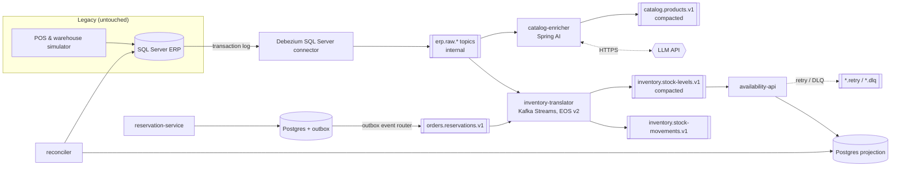

# Design — Legacy Inventory Modernization

> Status: **approved 2026-09-17**. Milestone 1 in progress.

## The problem this project solves

A mid-size retailer runs its inventory in a 15-year-old ERP on SQL Server.
Stores and the warehouse write stock movements into it all day. The online
store and a marketplace learn about stock from a **nightly CSV export over
SFTP**, so for up to 24 hours they sell units that no longer exist.

The ERP cannot be rewritten: it is the system of record, its vendor is gone,
and every change to it is risky. The business wants:

1. Stock availability on every sales channel within seconds, not a day.
2. To move online reservations out of the ERP, one capability at a time,
   without a big-bang cutover.
3. Proof that the new pipeline never loses or double-counts a unit, including
   when infrastructure fails.
4. Product data the online channels can use. ERP item descriptions look like
   `CAM MC AZ T-M ALG` and today someone cleans them up by hand.

This is a composite of a very common situation. The retailer is fictional.

## What the project demonstrates

| Client pain | Pattern shown | Evidence in the repo |
|---|---|---|
| Can't modify the legacy system | Change Data Capture (Debezium) | Legacy schema untouched; CDC reads the transaction log |
| Legacy data model leaks everywhere | Anti-corruption layer | Raw CDC topics are internal; only translated domain events are contracts |
| Big-bang rewrites fail | Strangler fig | Reservations move out of the ERP behind a routing switch |
| Dual writes lose data | Transactional outbox | New service writes state + event in one DB transaction |
| Duplicates after retries/rebalances | Idempotent consumers, Kafka Streams EOS | Chaos tests assert zero drift |
| Poison messages stall pipelines | Retry topics + DLQ | Test injects malformed events; pipeline keeps flowing |
| Schema changes break consumers | Schema Registry, compatibility rules | Evolution test with old and new consumers running together |
| "Is it actually correct?" | Continuous reconciliation | Job compares ERP totals with projections and alerts on drift |
| "Is it healthy?" | Metrics and consumer lag alerts | Grafana dashboards, Prometheus alert rules |
| Messy legacy product data | LLM enrichment with guardrails | Labelled eval set with accuracy and cost per 1,000 items |
| "Works on my machine" | Pinned toolchain, containerised build and runtime | Docker is the only requirement to run it; `docker compose up --build` |

## Architecture

### Components

**Legacy ERP (SQL Server + simulator).** The schema is deliberately ugly:
cryptic column names, `CHAR` status codes, a stored procedure that updates
stock and inserts a movement row. A simulator plays stores and the warehouse
at a configurable rate. We never change this schema to suit the new world.
That constraint is the point.

**Debezium on Kafka Connect.** Reads SQL Server CDC tables and publishes one
raw topic per table. The raw topics mirror the legacy model and are **not a
contract**. Only the two translating services (inventory-translator and
catalog-enricher) may consume them.

**inventory-translator (Kafka Streams).** This is the anti-corruption layer. It
maps raw rows to domain events (`StockMoved`, with SKU, location, quantity,
reason, and source timestamp) and keeps an `available = on_hand − reserved`
table keyed by `sku:location`. It uses `exactly_once_v2`, so reads, state
updates, and writes commit together inside Kafka.

**reservation-service (Spring Boot, the strangler step).** Owns online
reservations that used to live in the ERP. It writes the reservation and an
outbox row in one Postgres transaction. Debezium's outbox event router
publishes the outbox rows. A feature flag decides whether the storefront
reserves through the ERP or through this service. Flipping it is the strangler
move, and flipping it back is the rollback.

**availability-api (Spring Boot).** Consumes `stock-levels` into a Postgres
read model and serves `GET /availability/{sku}`. The consumer is idempotent:
each upsert is conditional on the event's version, so replays and duplicates
are no-ops. Transient failures go through retry topics. Anything still failing
goes to a DLQ with the original headers.

**reconciler.** Every N minutes it compares ERP stock with the projection per
SKU, publishes a drift metric, and alerts when drift is non-zero past a grace
window. Most "real-time" pipelines never prove they are right. This one does.

**catalog-enricher (Spring Boot + Spring AI).** Consumes product rows from
CDC and asks an LLM to turn cryptic ERP descriptions into structured
attributes (category, color, size, material) plus a customer-facing title.
The generation is the easy part. What the project shows is the boundary
around it:

- **Structured output, validated.** The response must parse into a schema
  and match closed vocabularies. Invalid output is retried once, then marked
  `needs_review`. It is never published as if it were correct.
- **Isolated from the stock path.** Enrichment has its own consumer group and
  topic. A slow, rate-limited, or down LLM API delays product titles and never
  delays stock levels.
- **Cost control.** Results are cached by a hash of the description, so an
  unchanged product is never sent twice. A daily token budget stops the
  consumer when it is exceeded, and cost per item is exported as a metric.
- **Measured quality.** A hand-labelled set of 200 legacy descriptions runs in
  CI against the prompt. Prompts are versioned files. A prompt change that
  lowers accuracy fails the build.
- **Runs without a key.** With no API key configured, a deterministic stub
  replaces the model, so anyone can clone and run the full system.
- **Minimal data sent.** Only the description and category code leave the
  system. No prices, stock, or supplier data.

**Observability.** Micrometer → Prometheus → Grafana. Dashboards track
end-to-end latency (ERP commit → API visible), consumer lag, DLQ rate, and
reconciliation drift.

### Topics and contracts

| Topic | Key | Cleanup | Contract |
|---|---|---|---|
| `erp.raw.dbo.INV_MOV`, `erp.raw.dbo.INV_STK`, `erp.raw.dbo.INV_ART` | table PK | delete, 7d | Internal, no guarantees |
| `inventory.stock-movements.v1` | `sku:location` | delete, 30d | Public, Avro, BACKWARD |
| `inventory.stock-levels.v1` | `sku:location` | compact | Public, Avro, BACKWARD |
| `orders.reservations.v1` | `sku:location` | delete, 30d | Public, Avro, BACKWARD |
| `catalog.products.v1` | `sku` | compact | Public, Avro, BACKWARD |
| `*.retry-N`, `*.dlq` | original | delete, 14d | Operational |

Keying by `sku:location` keeps all events for one stock position on one
partition, in order. That is the only ordering the domain needs.

## Failure scenarios (the part clients pay for)

Each scenario is a script plus an automated assertion. The README will publish
the measured results, not adjectives.

| # | Fault injected under load | Must hold |
|---|---|---|
| F1 | Kill one of three brokers | No lost or duplicated movements; reconciliation drift returns to 0 |
| F2 | Kill the translator mid-transaction | EOS: stock levels identical to a no-fault run |
| F3 | Restart Kafka Connect | CDC resumes from its offset; no gap in ERP LSNs |
| F4 | Inject malformed events | They land in the DLQ; healthy traffic latency unaffected |
| F5 | Deploy a v1 → v1.1 schema change (new optional field) | Old and new consumers run side by side without errors |
| F6 | Postgres projection down for 2 minutes | Lag grows, then drains; no data loss; alert fires and clears |
| F7 | Flip the reservation flag back and forth under load | No reservation lost or applied twice across the cutover |
| F8 | LLM API returns 429s, times out, then goes down | Stock latency unchanged; enrichment backs off, resumes, and catches up; no invalid output published |

Numbers to publish: sustained throughput, p50/p99 ERP-to-API latency, recovery
time per scenario, and drift after each run.

## Technology choices

| Choice | Why | Rejected alternative |
|---|---|---|
| Java 25 LTS + Spring Boot 4 | Current LTS; the owner's core stack | Java 21 / Boot 3: fine, but a new showcase should be on current versions |
| Maven multi-module | What most enterprise Java clients run | Gradle: no benefit for this audience |
| Apache Kafka 4.x, KRaft, 3 combined nodes | Minimum for RF=3 / `min.insync.replicas=2`, so F1 is meaningful; combined mode saves RAM | ZooKeeper: removed in Kafka 4 |
| Debezium on SQL Server | SQL Server is the most common legacy DB in client work; the Developer edition is free | Oracle + LogMiner: weeks of setup that add nothing to the story |
| Kafka Streams for the ACL | Stateful, EOS inside Kafka, no extra cluster | Flink: justified by scale this project doesn't have |
| Postgres read model | Shows the idempotent-consumer pattern explicitly | Streams interactive queries: harder to operate across instances |
| Confluent Schema Registry + Avro | De facto standard in client estates | Apicurio: equally valid, less common in job posts |
| Testcontainers | Integration tests against real brokers and databases | Embedded Kafka: hides real failure behaviour |
| Spring AI for LLM calls | Swapping OpenAI and Anthropic is a config change, which clients ask for; "Spring AI" is what Java shops search for | Vendor SDKs directly: first access to new provider features, but ties the code to one vendor. Revisit if Spring AI lacks something we need |
| Multi-stage Dockerfiles (build with `./mvnw` inside a JDK image, run on a JRE image) | A reviewer needs only Docker, not a JDK, to run everything | Jib: faster and reproducible, but requires a local JDK, which would be a second prerequisite for anyone cloning |
| `.sdkmanrc` + Maven Wrapper + enforcer | One pinned JDK read by SDKMAN and CI; pinned, checksum-verified Maven; wrong toolchain fails immediately | Documenting versions in the README only: drifts silently |
| Project-scoped `.mvn/settings.xml` | Corporate mirrors or profiles on a contributor's machine can't change how this project resolves dependencies | Relying on each machine's `~/.m2/settings.xml` |
| Pinned image tags in a committed `.env.example` | Same images on every machine; upgrades are a visible diff | `latest` tags: silent breakage |
| Docker Compose | Anyone can run it with one command | Kubernetes/Strimzi: operational weight that doesn't strengthen the message. Possible later chapter |

### Explicitly out of scope

- **Exactly-once into Postgres.** EOS covers Kafka-to-Kafka. At the database
  boundary the project uses idempotent upserts instead, and documents why.
  Claiming end-to-end EOS is a common red flag.
- **Cloud deployment.** A 24/7 cluster costs money and proves nothing that
  the local chaos runs don't. The website shows the case study and recordings.
- **Auth on the APIs.** Not the story here. Noted as a known gap.
- **RAG, agents, chat.** The LLM does one bounded job with a measurable result.
  Agents would make the demo flashier and the evidence weaker.
- **Python / FastAPI.** Belongs in project 2, the Python data-engineering
  pipeline, where it serves the lakehouse. A single Python service in a Java
  system just to list the keyword would read as padding to a reviewer.

## Local footprint

Target: runs on a 16 GB machine (WSL gets ~15 GB). Rough budget: Kafka 3 × 768 MB,
SQL Server 2 GB, Connect 1 GB, Schema Registry 512 MB, Postgres × 2 512 MB,
Prometheus + Grafana 512 MB, services 3 × 384 MB. About 8–9 GB total.

**Portability notes.** The SQL Server image is published for x86-64 only. On
Apple Silicon it runs under Rosetta emulation (enable it in Docker Desktop),
which works but is slower. Compose files avoid host networking and absolute
host paths, which don't behave the same on macOS and Windows.

## Milestones (8–10 h/week, 7 weeks)

| Week | Deliverable | Done when |
|---|---|---|
| 1 | Repo bootstrap, Compose stack, legacy schema + simulator, Debezium streaming raw CDC | `docker compose up` then movements appear in `erp.raw.*` |
| 2 | Translator with Avro contracts, EOS, stock-levels table | Testcontainers test: ERP rows → correct levels |
| 3 | availability-api projection, idempotency, retry/DLQ, reconciler | F4 passes; drift metric exported |
| 4 | reservation-service, outbox, strangler flag | F7 passes |
| 5 | catalog-enricher: structured output, cache, budget, stub, eval set in CI | Eval accuracy and cost per 1,000 items published; F8 passes |
| 6 | Grafana dashboards, alert rules, F1–F6 scripted with results | Results table generated from runs |
| 7 | README case study, ADRs, diagrams, recording; page on joseherrera.dev | A client can understand it in 3 minutes |

## Open decisions

Resolved on 2026-09-17: repository name `legacy-inventory-modernization`, MIT
license, English for docs and code, Java 25.
